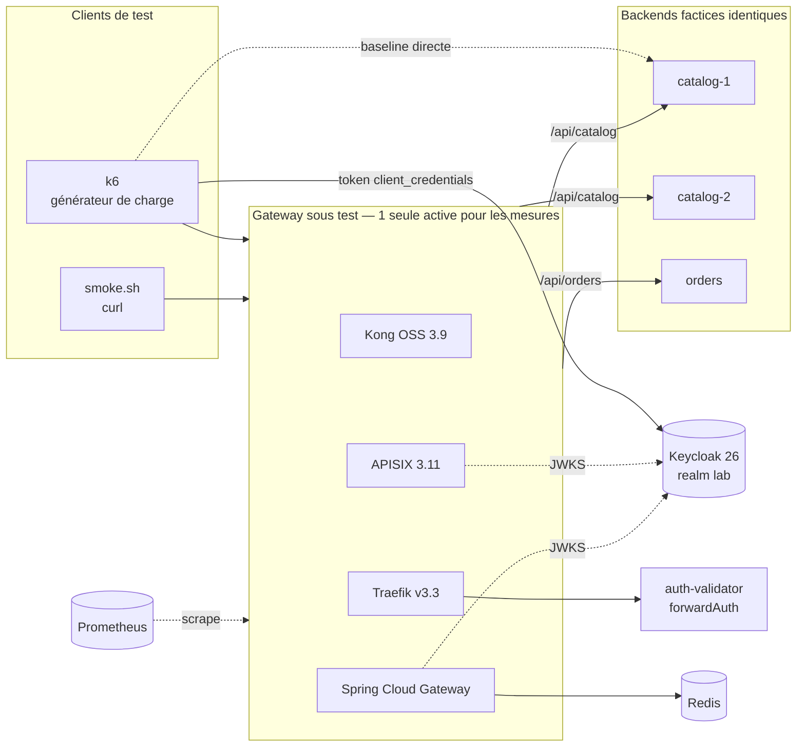

# 2. Architecture du POC

## 2.1 Schéma

- Tout tourne dans **un seul `docker-compose.yml`** ; chaque gateway est un **profil** (`kong`, `apisix`, `traefik`, `scg`).
- k6 tourne **dans le réseau Docker** (profil `tools`) : on évite le bruit du NAT de l'hôte et on mesure le même chemin réseau pour toutes les solutions.
- La baseline « direct » attaque `catalog-1` sans gateway : c'est la référence pour calculer le surcoût.

## 2.2 Composants et versions

| Composant | Image | Rôle |
|---|---|---|
| catalog-1, catalog-2, orders | `lab/backend:1.0` (Node 22, zéro dépendance) | API factice ; renvoie `X-Instance`, écho des en-têtes de corrélation ; `/admin/chaos` pour injecter latence/erreurs |
| keycloak | `quay.io/keycloak/keycloak:26.1` | IdP de test, realm `lab` importé, **clé RSA fixe** (`identity/keys`) pour que toutes les gateways valident le même token |
| auth-validator | `lab/auth-validator:1.0` (Node 22) | Validation JWT externalisée pour Traefik (`forwardAuth`) |
| redis | `redis:7.4-alpine` | Stockage des compteurs du `RequestRateLimiter` de SCG |
| kong | `kong:3.9.1` | DB-less, `gateways/kong/kong.yml` |
| apisix | `apache/apisix:3.11.0-debian` | Standalone, `gateways/apisix/apisix.yaml` |
| traefik | `traefik:v3.3` | `gateways/traefik/traefik.yml` + `dynamic.yml` |
| scg | `lab/scg:1.0` (build Maven, JRE 21) | `gateways/scg/src/main/resources/application.yml` |
| k6 | `grafana/k6:0.57.0` | Scripts `tests/k6/*.js` |
| prometheus | `prom/prometheus:v3.2.1` | Scrape des 4 gateways (profil `obs`) |

> Les versions sont figées pour la reproductibilité. Avant la soutenance, vérifier qu'aucune version plus récente ne change une conclusion (notamment Kong : la lignée OSS s'arrête à la 3.9.x, voir § 2.5).

## 2.3 Ressources et équité

| Élément | Limite |
|---|---|
| Chaque gateway | 1 vCPU, 512 Mo (`x-gw-limits`, via `deploy.resources.limits` ; vérifier avec `scripts/check-limits.sh`) |
| Kong / APISIX | 1 worker NGINX (cohérent avec 1 vCPU) |
| SCG | JVM `MaxRAMPercentage=75` (≈ 384 Mo de heap max) |
| Chaque backend | 0,5 vCPU, 256 Mo |

Règles appliquées à toutes les mesures :
1. **Une seule gateway active** pendant un test de performance (`docker compose --profile <gw> up`).
2. **Même parcours, mêmes données** (`backends/data/*.json`, générés avec une graine fixe).
3. **Échauffement** : un run de 30 s jeté avant chaque mesure (crucial pour la JVM de SCG, JIT).
4. **3 répétitions** par mesure ; on retient la médiane et on note l'écart min–max.
5. Noter la machine hôte (CPU, RAM, OS, version Docker) dans le journal de tests.

## 2.4 Ports exposés sur l'hôte

| Service | Port hôte |
|---|---|
| Kong (proxy / admin / status) | 8001 / 18001 / 18100 |
| APISIX (proxy / métriques) | 8002 / 19091 |
| Traefik (proxy / dashboard / métriques) | 8003 / 18083 / 18082 |
| SCG | 8004 (actuator : `/actuator/prometheus`, `/actuator/gateway/routes`) |
| catalog-1 / catalog-2 / orders (direct) | 9001 / 9002 / 9003 |
| Keycloak | 8180 (API token ; console admin via `kcadm.sh`, cf. E2) |
| Prometheus | 9090 |

## 2.5 Comparable vs spécifique : ce que chaque solution fait nativement

Légende : **N** natif (édition gratuite) · **P** plugin/middleware fourni gratuit · **X** externe ou code à écrire · **€** édition payante uniquement.
Les cases marquées † sont à **confirmer par les tests** (c'est le rôle des expériences).

| Fonction | Kong OSS 3.9 | APISIX 3.11 | Traefik v3.3 | SCG 4.2 |
|---|---|---|---|---|
| Routage par chemin | N | N | N | N |
| Répartition de charge + health checks | N (upstreams) | N | N | N via Spring Cloud LoadBalancer (health checks : config dédiée) |
| Validation JWT statique (clé publique) | P `jwt` | P `jwt-auth` | X (`forwardAuth` + service) | N (Spring Security) |
| Validation JWT via JWKS / OIDC | € `openid-connect` | P `openid-connect` | X (Traefik Hub = €) | N (`jwk-set-uri`) |
| Rate limiting par clé | P `rate-limiting` (fenêtre fixe) ; fenêtre glissante = € | P `limit-count`, `limit-req` | P `rateLimit` (token bucket) | P `RequestRateLimiter` (**Redis requis**) |
| Retries / timeouts | N | N | P `retry` + serversTransport | P `Retry` + httpclient |
| Circuit breaker | X (pas de CB ; health checks passifs comme substitut) | P `api-breaker` | P `circuitBreaker` | P Resilience4j |
| Identifiant de corrélation | P `correlation-id` | P `request-id` | X (non généré nativement ; via tracing OTel) | X (filtre de 15 lignes) / traceId Micrometer |
| Métriques Prometheus | P `prometheus` | P `prometheus` | N | N (Actuator + Micrometer) |
| CORS | P `cors` | P `cors` | P `headers` | N `globalcors` |
| Reconfiguration à chaud | N (`POST /config` en DB-less ; Admin API avec DB) | N (fichier surveillé / etcd + Admin API) | N (provider surveillé) | X (redéploiement ; actuator refresh non persistant) |
| Portail développeur / cycle de vie API | € (Konnect) | Dashboard open source, pas de portail complet | € (Traefik Hub) | X |

## 2.6 Gateway, reverse proxy, API management

- **Reverse proxy** (Traefik Proxy, NGINX open source) : routage, TLS, équilibrage ; les politiques d'API (auth, quotas) arrivent via middlewares, souvent limitées en version gratuite.
- **API Gateway** (Kong, APISIX, SCG) : point d'entrée qui **applique des politiques par API/consommateur** (auth, quotas, transformation, résilience).
- **API management** (Kong Konnect, Traefik Hub, Apigee, Azure APIM…) : gateway **+** portail développeur, catalogue, gestion des versions, plans d'abonnement, analytics. **Aucune des 4 solutions OSS testées n'est une plateforme d'API management complète** : le comparatif porte sur la couche gateway.

## 2.7 Points de vigilance identifiés à la conception

| Sujet | Impact sur la comparaison |
|---|---|
| Kong OSS : la lignée open source s'arrête à la 3.9.x, les évolutions vont à l'édition Enterprise / Konnect | Risque de pérennité à intégrer au critère « Coûts / licences » |
| Kong `jwt` OSS ne lit pas le JWKS : la clé publique est copiée dans la config | Rotation de clés manuelle → critère sécurité/exploitation |
| Traefik : pas de JWT natif en OSS → service `auth-validator` ajouté | Un saut réseau de plus sur `/api/orders` : **le surcoût mesuré inclut ce saut**, à signaler |
| Algorithmes de quota différents (fenêtre fixe Kong/APISIX vs token bucket Traefik/SCG) | Même réglage « 10 req/s » ≠ même comportement en rafale → objet de l'expérience rate limiting |
| Rate limiting « local » (Kong, APISIX, Traefik) vs Redis (SCG) | En haute dispo à N instances, un quota local est multiplié par N → à discuter dans l'analyse |
| SCG : JVM (temps de démarrage, mémoire, JIT) | Échauffement obligatoire avant mesure |
| Kong/APISIX : 1 worker NGINX ; Traefik (Go) et SCG (Netty) utilisent tous les threads dispo dans 1 vCPU | Équité par la limite CPU, pas par le nombre de threads |
