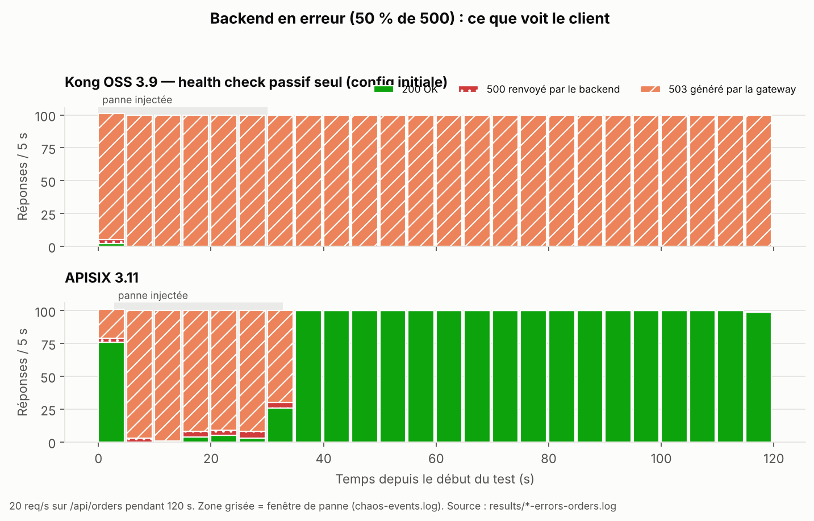

# 4. Note de décision — Choix d'une API Gateway pour NordFlux

## Contexte et exigences

NordFlux expose une douzaine de microservices à des clients web, mobiles et internes. Il lui faut un point d'entrée unique qui :
- valide les JWT émis par Keycloak ;
- limite les abus à 10 req/s par client ;
- protège les clients des pannes de backend ;
- permet de suivre une requête de bout en bout.

Pic visé : 1 500 req/s. Cible de production : Kubernetes. Contrainte : les fonctions cœur doivent être disponibles sans licence payante.

## Ce qui a été comparé

**Kong Gateway OSS 3.9.1** et **Apache APISIX 3.11**, en édition gratuite, sur un parcours identique :
- deux API factices (catalogue sur 2 instances, commandes sur 1) ;
- Keycloak et des jeux de données figés ;
- **1 vCPU / 512 Mo par gateway**, limite vérifiée par `docker inspect`.

Sept expériences ont été menées, toutes rejouables (dépôt Git, `results/`, `docs/graphs/`). Traefik et Spring Cloud Gateway sont configurés dans le dépôt mais n'ont pas été mesurés : le périmètre a été réduit à deux solutions, ce que le sujet autorise.

## Résultats marquants

| Expérience | Kong OSS | APISIX |
|---|---|---|
| Routage (E1) | 5/5 | 5/5 |
| Authentification (E2) | 9/9, clé publique statique | 9/9, JWKS |
| Quota 10 req/s (E3) | 10,27 req/s, 11,4 par rafale | 10,00 req/s, 10 par rafale |
| Surcoût P95 à 200 req/s (E4) | +1,60 ms | **+0,58 ms** |
| Coût du JWT, P50 (E4) | ≈ 0 ms | +0,5 ms |
| 3 000 req/s sur 1 vCPU (E4) | 0 erreur, P95 36 ms, CPU 97 % | 0 erreur, **P95 1,6 ms, CPU 53 %** |
| RAM sous charge (E4) | ~205 Mo | **~52 Mo** |
| Perte d'une instance (E5) | 0 erreur | 0 erreur |
| Backend à 50 % d'erreurs (E5) | **99,9 % d'erreurs, aucune récupération** | 24 % d'erreurs, **retour à la normale < 10 s** |
| Corrélation (E6) | `X-Request-ID` + latences dans chaque réponse | `X-Request-ID` |

**Le résultat décisif est la résilience** (graphique `06-circuit-breaker.png`). Kong OSS n'a pas de circuit breaker. Son health check passif a retiré le backend après 3 erreurs, puis ne l'a **jamais réintégré** : une panne de 30 s est devenue une coupure durable, jusqu'au redémarrage de Kong. APISIX a ouvert son circuit pendant la panne, laissé passer quelques requêtes de test, puis l'a refermé dès le retour du backend.

## Matrice (synthèse)

| | Kong OSS | APISIX |
|---|---|---|
| Critères éliminatoires | aucun déclenché | aucun déclenché |
| Score pondéré (contexte microservices) | 3,30 / 5 | **4,45 / 5** |
| Score pondéré (« performance d'abord ») | 3,27 / 5 | **4,51 / 5** |

Le détail et les justifications sont dans `03-matrice-decision.md`. Le classement est stable quelle que soit la pondération.

## Recommandation

**Apache APISIX** pour NordFlux.

Il l'emporte sur les deux critères les plus lourds du contexte microservices :
- **la résilience**, avec un circuit breaker qui se referme seul ;
- **la sécurité**, avec une validation JWKS qui suit la rotation des clés Keycloak sans reconfiguration.

Il est aussi nettement plus sobre sous charge, et tout ce qui a été utilisé est disponible en Apache 2.0.

**Conditions de mise en œuvre :**
- réduire les messages d'erreur JWT, qui révèlent la cause du refus à un éventuel attaquant ;
- masquer l'en-tête `Server` ;
- passer le rate limiting sur Redis dès qu'il y a plus d'une instance de gateway, sinon le quota est multiplié par le nombre d'instances ;
- en production, déployer avec etcd ou l'Ingress Controller plutôt qu'en mode standalone.

**Quand Kong resterait pertinent.** Kong OSS reste solide sur le routage, le failover et surtout l'observabilité prête à l'emploi : la latence gateway et la latence backend sont visibles dans chaque réponse. Il conviendrait à un contexte où la résilience est portée ailleurs, par exemple un service mesh. Deux réserves s'appliqueraient :
- ajouter **systématiquement** un health check actif sur chaque upstream ;
- tenir compte du gel de la lignée OSS à la 3.9.x : OIDC/JWKS et les quotas avancés sont en édition payante.

## Compromis assumés

- **APISIX valide les tokens un peu plus lentement** (+0,5 ms en médiane), c'est le prix du JWKS. C'est négligeable devant le gain de sécurité opérationnelle.
- **APISIX a été plus délicat à démarrer** (incident de configuration au premier lancement). Il demande un peu plus de maîtrise de la configuration.

## Limites de validité

- **Mesures sur un poste de développement** (MacBook Air sous Docker Desktop), sans TLS, avec une seule instance de gateway : les résultats valent **en relatif**, pas comme dimensionnement de production.
- **Incidents de protocole détectés et corrigés en cours de route :**
  1. la limite CPU était ignorée par Docker Desktop macOS : mesures de performance rejouées avec `deploy.resources`, puis vérifiées ;
  2. le générateur k6 saturait en allouant ses utilisateurs virtuels : 600 pré-alloués ;
  3. bruit de l'hôte : runs avec requêtes perdues rejoués, médiane de 3 runs ;
  4. un bug du script de latence sur la route protégée, corrigé.
- **Écart de configuration non neutralisé :** Kong avait davantage de métriques Prometheus actives qu'APISIX. Une partie de l'écart de CPU peut en venir.
- **Expériences non réalisées :** déploiement à chaud (E8), capture Prometheus (E6, partielle), scénarios backend lent et arrêt complet de orders, haute disponibilité et Kubernetes.

## Prochaines étapes

1. Rejouer E3 et E5 sur un cluster Kubernetes de test, avec 2 instances d'APISIX et le rate limiting sur Redis.
2. Mesurer E8 (changement de route sans interruption) et activer le tracing OpenTelemetry de bout en bout.
3. Optionnel : rejouer Kong avec un health check actif sur `orders` et des métriques allégées, pour quantifier ce qui relève de la configuration et ce qui relève du produit.
