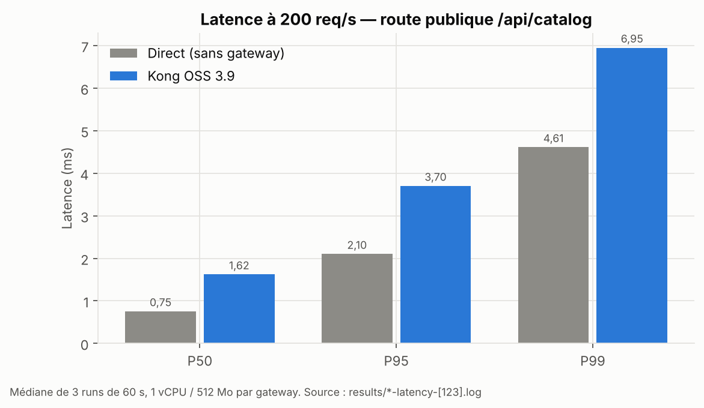
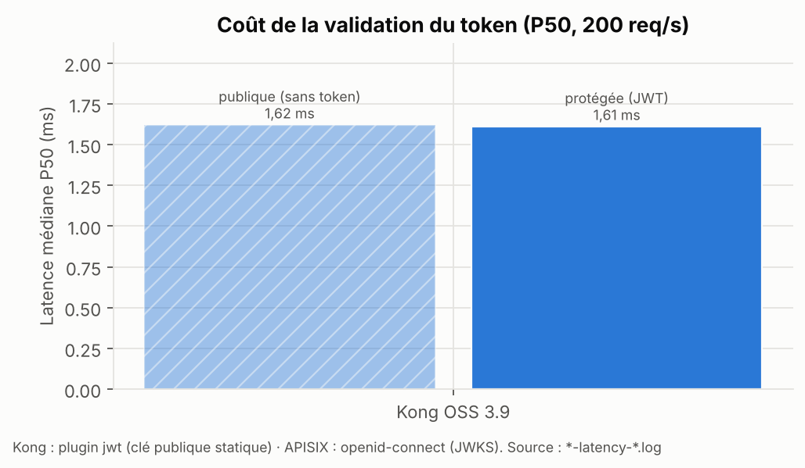
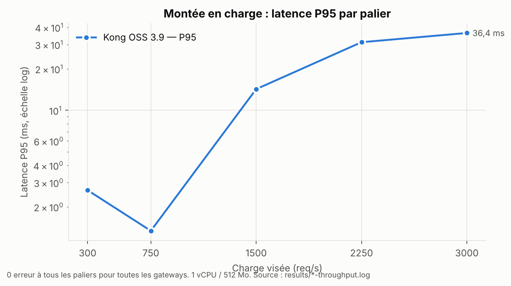
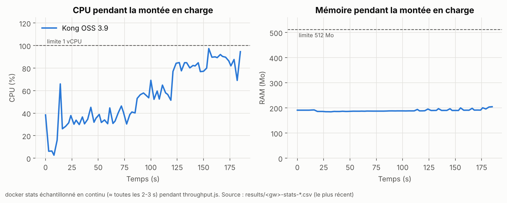
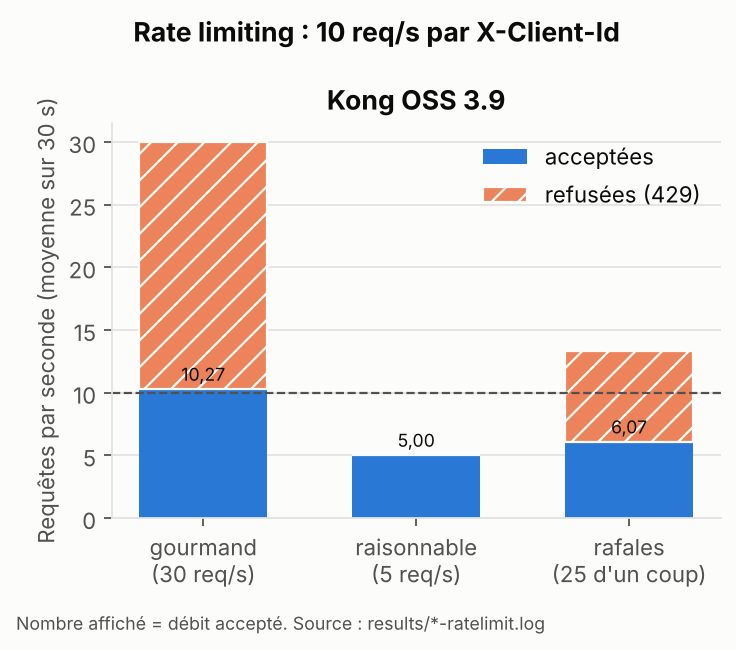
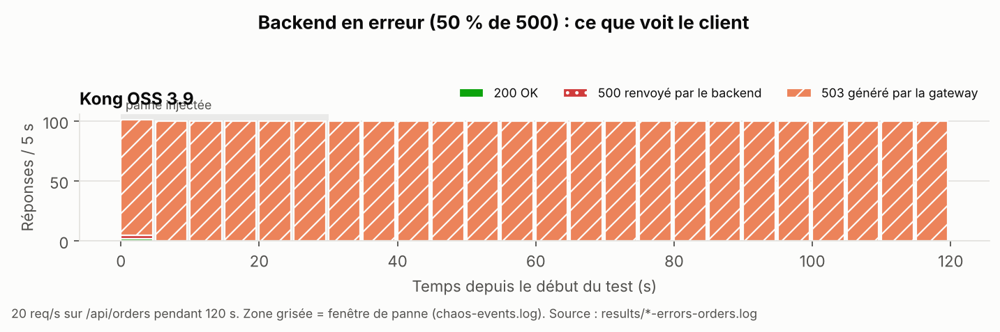
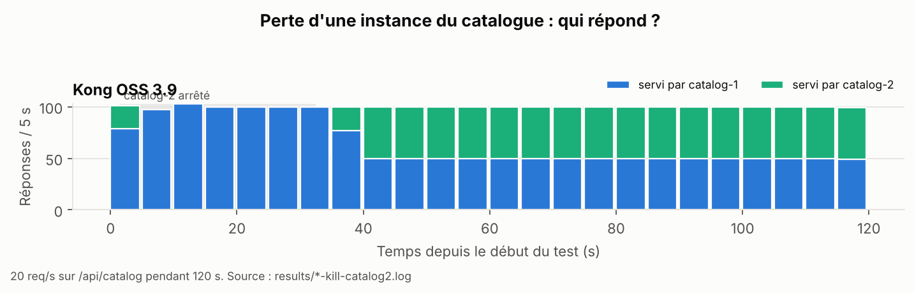

# Graphiques

Générés par `python3 scripts/graphs.py` à partir des fichiers de `results/`.

## Latence P50/P95/P99 à 200 req/s

## Coût de la validation JWT

## Latence P95 par palier de charge

## CPU et RAM pendant la montée en charge

## Rate limiting par client

## Backend en erreur (50 % de 500) : ce que voit le client

## Failover lors de la perte d'une instance

