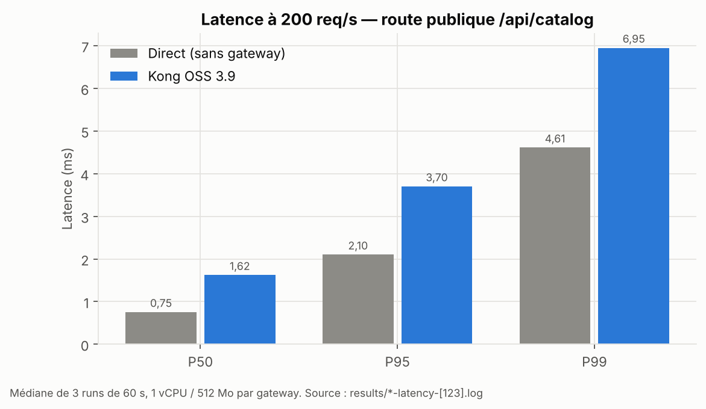
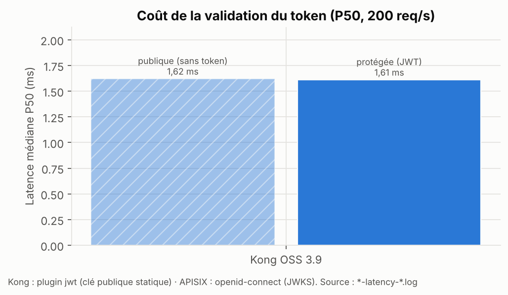
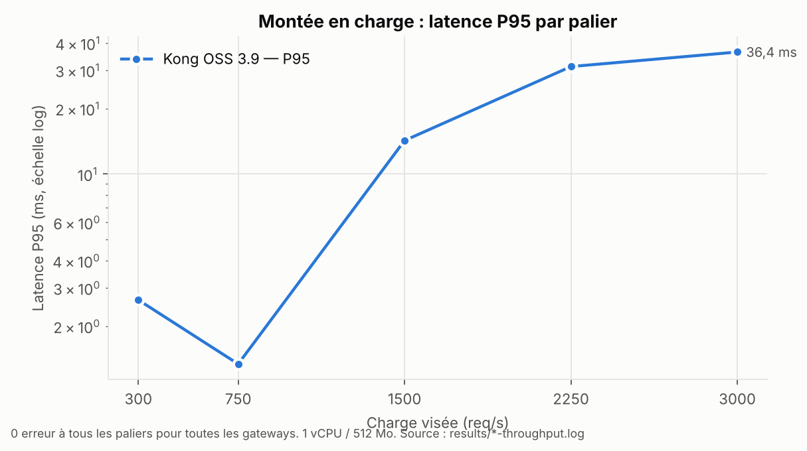
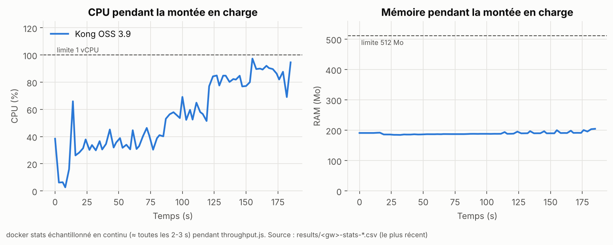

# E4 — Latence et débit (expérience performance)

**Objectif** — Mesurer le surcoût de latence de chaque gateway par rapport à un appel direct, puis son débit max sous 1 vCPU / 512 Mo.

**Hypothèse**
- À 200 req/s, surcoût P95 de quelques ms pour Kong, APISIX et Traefik ; SCG légèrement au-dessus (pile réactive JVM) mais sous le seuil S3 (+10 ms) après échauffement.
- En débit, Kong et APISIX (NGINX/OpenResty) saturent le plus tard ; Traefik ensuite ; SCG plafonne plus tôt et consomme le plus de RAM.
- Sur `/api/orders`, Traefik paie un saut réseau supplémentaire (forwardAuth) → surcoût plus élevé que sur `/api/catalog`.

**Environnement** — Une seule gateway lancée ; machine hôte au repos (fermer IDE/navigateur si possible) ; noter CPU/RAM de l'hôte.

**Procédure**
1. Baseline : `docker compose --profile tools run --rm k6 run /scripts/latency.js -e TARGET=direct`
2. Pour chaque gateway :
   - échauffement : `... latency.js -e TARGET=<gw> -e DURATION=30s` (résultat jeté) ;
   - 3 mesures : `... latency.js -e TARGET=<gw>` (200 req/s, 60 s) ;
   - route protégée : `... latency.js -e TARGET=<gw> -e ENDPOINT=orders`.
3. Débit : terminal 1 `./scripts/stats.sh <gw>` ; terminal 2 `... throughput.js -e TARGET=<gw>` (paliers 300 → 3 000 req/s).
4. Point de saturation = premier palier où `http_req_failed` > 1 % **ou** P95 > 100 ms **ou** k6 signale `dropped_iterations`.

**Mesures** — P50 / P95 / P99 (`med`, `p(95)`, `p(99)` du résumé `http_req_duration`) ; surcoût = gateway − direct ; RPS max soutenu ; CPU % et RAM max (`results/<gw>-stats-*.csv`).

**Résultat** — *à compléter* (médiane de 3 runs)

| | Direct | Kong | APISIX | Traefik | SCG |
|---|---|---|---|---|---|
| P50 catalog (ms) | 0,75 | 1,62 | 1,51 | | |
| P95 catalog (ms) | 2,10 | 3,70 | 2,68 | | |
| P99 catalog (ms) | 4,61 | 6,95 | 5,38 | | |
| Surcoût P95 catalog (ms) | — | +1,60 (P50 +0,87 ; P99 +2,34) | +0,58 (P50 +0,76 ; P99 +0,77) | | |
| P95 orders avec JWT (ms) | — | 3,58 (P50 1,61) | 3,67 (P50 2,04) | | |
| RPS max soutenu | — | ≥ 3 000 sans erreur (CPU ~100 %, P95 36 ms) | ≥ 3 000 sans erreur (CPU ~53 %, P95 1,6 ms) | | |
| CPU au palier max (%) | — | 97 (limite 100) | 53 | | |
| RAM max (Mo) | — | ~205 / 512 | ~52 / 512 | | |

> ⚠️ **Incident de protocole (02/11, 11:08)** — `docker inspect` a montré `NanoCpus=0` : sur Docker Desktop macOS, la clé `cpus:` au niveau service était **ignorée**. Les mesures Kong ci-dessous (latence et débit) ont donc été faites **sans limite CPU** (seule la limite RAM de 512 Mo était active). Correctif : limites passées en `deploy.resources.limits` + script `scripts/check-limits.sh`. Les mesures de perf Kong sont **rejouées** avec la limite ; les anciennes sont conservées pour trace mais exclues de la comparaison.

**Kong — mesures retenues, avec limite 1 vCPU vérifiée (`check-limits.sh`)**

| Run | Route | P50 (ms) | P95 (ms) | P99 (ms) | Erreurs | dropped | Fichier |
|---|---|---|---|---|---|---|---|
| 1 | catalog | 1,62 | 3,68 | 6,07 | 0 % | 0 | `kong-latency-1.log` |
| 2 | catalog | 1,57 | 3,72 | 6,95 | 0 % | 0 | `kong-latency-2.log` |
| 3 | catalog | 1,62 | 3,70 | 7,14 | 0 % | 0 | `kong-latency-3.log` |
| — | orders (JWT) | 1,61 | 3,58 | 8,13 | 0 % | 0 | `kong-latency-orders.log` |

Lecture : runs très reproductibles (écart P95 < 0,05 ms). Médiane catalog : P50 1,62 / P95 3,70 / P99 6,95 ms. La validation JWT ne coûte rien de mesurable en médiane (1,61 vs 1,62 ms).

**APISIX — mesures retenues, limite 1 vCPU vérifiée**

| Run | Route | P50 (ms) | P95 (ms) | P99 (ms) | Erreurs | dropped | Fichier |
|---|---|---|---|---|---|---|---|
| 1 | catalog | 1,48 | 2,68 | 5,38 | 0 % | 0 | `apisix-latency-1.log` |
| 2 | catalog | 1,51 | 2,64 | 4,80 | 0 % | 0 | `apisix-latency-2.log` |
| 3 | catalog | 1,54 | 2,79 | 5,64 | 0 % | 0 | `apisix-latency-3.log` |
| — | orders (JWT/OIDC) | 2,04 | 3,67 | 8,90 | 0 % | 0 | `apisix-latency-orders.log` |

Lecture : médiane catalog P50 1,51 / P95 2,68 / P99 5,38 ms, soit un surcoût P95 de **+0,58 ms** (Kong : +1,60 ms). En revanche la validation du token coûte davantage chez APISIX (P50 +0,5 ms sur orders vs catalog, contre ≈ 0 chez Kong) : le plugin `openid-connect` (bibliothèque OIDC complète, JWKS) est plus lourd que le plugin `jwt` de Kong (vérification RSA avec clé statique).

*Les tableaux suivants (« mesures brutes ») sont l'historique avant correction de la limite CPU — conservés pour trace.*

**Mesures brutes (200 req/s, 60 s, route catalog)**

| Run | Cible | P50 (ms) | P95 (ms) | P99 (ms) | Erreurs | dropped_iterations | Fichier |
|---|---|---|---|---|---|---|---|
| 1 | direct | 0,77 | 2,10 | 4,61 | 0 % | 0 | `direct-latency-1.log` |
| 2 | direct | 0,75 | 2,20 | 5,18 | 0 % | 0 | `direct-latency-2.log` |
| 3 | direct | 0,75 | 2,10 | 4,16 | 0 % | 0 | `direct-latency-3.log` |
| échauffement | kong (30 s) | 1,30 | 3,39 | 6,81 | 0 % | 0 | jeté |
| 1 | kong | 1,55 | 3,55 | 5,65 | 0 % | 0 | `kong-latency-1.log` |
| 2 (rejoué) | kong | 1,57 | 4,06 | 19,57 | 0 % | 0 | `kong-latency-2.log` |
| 3 (rejoué) | kong | 1,83 | 3,65 | 5,61 | 0 % | 0 | `kong-latency-3.log` |
| 2 et 3 initiaux | kong | 1,63 / 1,74 | 15,48 / 7,37 | 120 / 79,9 | 0 % | 118 / 15 | écartés (hôte saturé) |

> Règle de validité adoptée : un run avec `dropped_iterations` > 0 signale que **le générateur (k6) ou l'hôte** a saturé, pas forcément la gateway. Ces runs sont rejoués machine au repos ; s'ils restent bruités, ils sont conservés et signalés. Machine : MacBook Air (refroidissement passif → bridage thermique possible sous charge prolongée, d'où une pause de 1–2 min entre runs).
>
> Lecture provisoire Kong : la **médiane** est stable (+0,8 à +1 ms vs direct) ; les écarts portent sur la **queue** (P95/P99), sensible au bruit de l'hôte.

**Débit Kong par palier (run 2, `results/kong-throughput.log`)** — fenêtre de 35 s = montée 5 s + palier 30 s

| Palier visé | Requêtes attendues | Servies | % servi | P95 (ms) | P99 (ms) | Erreurs |
|---|---|---|---|---|---|---|
| 300 | 10 000 | 9 998 | 100 % | 2,55 | 5,6 | 0 % |
| 750 | 25 125 | 25 119 | 100 % | 1,44 | 5,5 | 0 % |
| 1 500 | 50 625 | 49 074 | 96,9 % | 2,46 | 35,5 | 0 % |
| 2 250 | 76 875 | 72 658 | 94,5 % | 103,75 | 451,9 | 0 % |
| 3 000 | 103 125 | 103 140 | 100 % | 18,66 | 45,4 | 0 % |

Lecture : la dégradation n'est **pas monotone** (2 250 pire que 3 000). Les itérations perdues (5 755) coïncident avec la phase où k6 **alloue de nouveaux VU** (200 pré-alloués → 508) : artefact du générateur, pas saturation de Kong. Au palier 3 000, tout est servi avec P95 = 18,7 ms et 0 erreur → **Kong tient ≥ 3 000 req/s avec 1 vCPU / 1 worker** (critère S4 validé). Correctif pour la suite : `preAllocatedVUs` porté à 600 (Kong rejoué avec ce réglage pour garder la comparaison équitable).

**Débit APISIX — run retenu, limite 1 vCPU vérifiée (`results/apisix-throughput.log`)**

| Palier visé | Attendues | Servies | % servi | P50 (ms) | P95 (ms) | P99 (ms) | Erreurs |
|---|---|---|---|---|---|---|---|
| 300 | 10 000 | 9 996 | 100 % | 0,95 | 2,63 | 112,7 | 0 % |
| 750 | 25 125 | 25 031 | 99,6 % | 0,37 | 0,92 | 3,5 | 0 % |
| 1 500 | 50 625 | 50 713 | 100 % | 0,29 | 0,81 | 5,6 | 0 % |
| 2 250 | 76 875 | 76 867 | 100 % | 0,28 | 0,87 | 4,4 | 0 % |
| 3 000 | 103 125 | 103 113 | 100 % | 0,27 | 1,61 | 10,5 | 0 % |

Pic conteneur : **~53 % CPU**, **~52 Mo RAM** / 512.

Lecture : APISIX sert 3 000 req/s avec une **marge importante** (CPU à moitié, P95 1,6 ms), là où Kong était à 97 % CPU et P95 36 ms sur le même palier. Écart à nuancer : Kong a ici davantage de métriques Prometheus actives (`latency_metrics`, `bandwidth_metrics`, `upstream_health_metrics`) et le plugin `correlation-id` ; une partie de l'écart de CPU peut venir de là (test complémentaire possible : Kong sans ces métriques). Le P99 élevé du palier 300 (premières secondes) est un effet de démarrage, pas de charge.

**Débit Kong — RUN RETENU, limite 1 vCPU vérifiée (`results/kong-throughput.log`, `results/kong-stats-*.csv` le plus récent)**

| Palier visé | Attendues | Servies | % servi | P50 (ms) | P95 (ms) | P99 (ms) | Erreurs |
|---|---|---|---|---|---|---|---|
| 300 | 10 000 | 9 998 | 100 % | 1,26 | 2,64 | 9,6 | 0 % |
| 750 | 25 125 | 25 124 | 100 % | 0,49 | 1,34 | 5,7 | 0 % |
| 1 500 | 50 625 | 50 627 | 100 % | 0,52 | 14,26 | 117,5 | 0 % |
| 2 250 | 76 875 | 76 876 | 100 % | 0,43 | 31,20 | 134,9 | 0 % |
| 3 000 | 103 125 | 103 112 | 100 % | 0,61 | 36,39 | 97,5 | 0 % |

0 itération perdue, 0 erreur. Pic conteneur : **97 % CPU** (plafonné par la limite), **~205 Mo RAM**.

Lecture : Kong sert **3 000 req/s sans erreur sur 1 vCPU**, mais il est **proche de la saturation** : CPU à ~100 % et queue de latence qui se dégrade dès 1 500 req/s (P95 1,3 → 14 ms, P99 > 100 ms). La médiane reste < 1 ms : la majorité des requêtes n'est pas affectée, ce sont les files d'attente du worker unique qui allongent la queue. Critère S4 (≥ 1 500 req/s sans erreur) **validé**.

*Runs ci-dessous : historique sans limite CPU, exclus de la comparaison.*

**Débit Kong — run retenu (run 3, `preAllocatedVUs: 600`, `results/kong-throughput.log`)**

| Palier visé | Attendues | Servies | % servi | P50 (ms) | P95 (ms) | P99 (ms) | Erreurs |
|---|---|---|---|---|---|---|---|
| 300 | 10 000 | 9 998 | 100 % | 1,07 | 24,27 | 537,6 | 0 % |
| 750 | 25 125 | 25 070 | 99,8 % | 0,48 | 299,83 | 686,6 | 0 % |
| 1 500 | 50 625 | 50 624 | 100 % | 0,48 | 1,34 | 4,9 | 0 % |
| 2 250 | 76 875 | 76 877 | 100 % | 0,40 | 4,42 | 21,4 | 0 % |
| 3 000 | 103 125 | 103 111 | 100 % | 0,60 | 25,74 | 55,9 | 0 % |

Itérations perdues : 54 sur 265 734 (0,02 %). Pic conteneur : ~120 % CPU (limite à vérifier, cf. ci-dessous), ~206 Mo RAM / 512.

Lecture : 0 erreur et ≈ 100 % servi à tous les paliers → **Kong soutient 3 000 req/s** (P95 25,7 ms). Les queues anormales aux paliers **bas** (750 : P95 300 ms) ne suivent pas la charge : pic transitoire côté hôte (577 VU occupés simultanément = blocage d'environ 0,9 s de toutes les requêtes en vol). À signaler comme bruit de mesure, pas comme limite de Kong.

**Graphiques**

**Limites de validité** — Docker sur un poste de dev ≠ production ; k6 partage le CPU de l'hôte ; pas de TLS ; résultats à relire en *relatif* entre solutions, pas en absolu.

**Décision** — Les deux respectent largement les seuils (S3 : +10 ms ; S4 : 1 500 req/s). APISIX garde une marge importante sous charge (CPU 53 %, P95 1,6 ms à 3 000 req/s) quand Kong approche de la saturation (CPU 97 %, P95 36 ms). Avantage APISIX, avec la réserve de la configuration de métriques plus chargée côté Kong.
